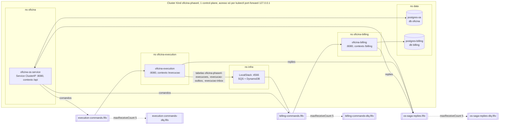

# Diagrama geral da Fase 4 (Kind efêmero, validação local)

Reconciliado com os manifestos de `infra/phase4-kind/` (core, SHA de origem `c2c8422`) e com os overlays `k8s/` de billing (`585c786`) e execution (`89e653a`, `k8s/local`). Representa o ambiente descartável de validação local; **não** é evidência de deploy em nuvem e não usa recurso AWS (LocalStack com credenciais fictícias).

## Conferência contra os manifestos

| Elemento | Fonte |
|---|---|
| Namespaces `infra`, `data`, `oficina`, `oficina-billing`, `oficina-execution` | `infra/phase4-kind/manifests/namespaces.yaml` |
| `postgres-os` (db `oficina`) e `postgres-billing` (db `billing`), ambos no ns `data`, Postgres 16 | `infra/phase4-kind/manifests/postgres-*.yaml` |
| LocalStack no ns `infra`, serviços `sqs,dynamodb`, porta 4566 | `infra/phase4-kind/manifests/localstack.yaml` |
| Filas FIFO `billing-commands`, `execution-commands`, `os-saga-replies`, cada uma com DLQ `*-dlq.fifo` e `maxReceiveCount` 5; `notifications.fifo` sem DLQ | `infra/phase4-kind/localstack/init.sh` |
| Tabelas DynamoDB do execution: `oficina-phase4-execucoes`, `-execucao-outbox`, `-execucao-inbox` | `infra/phase4-kind/localstack/init.sh`; `k8s/local/configmap.yaml` do execution |
| Variáveis de fila do core (`SAGA_FILA_BILLING`, `SAGA_FILA_EXECUCAO`, `SAGA_FILA_RESPOSTAS`) | `infra/phase4-kind/os-service/configmap.yaml` |
| Variáveis de fila do billing e do execution (comandos próprios, replies em `os-saga-replies`) | `k8s/base/configmap.yaml` (billing); `k8s/local/configmap.yaml` (execution) |
| Nenhum NodePort/extraPortMappings; acesso por `port-forward` em 127.0.0.1 | `infra/phase4-kind/kind-config.yaml` |

Limites: `notifications.fifo` é criada pelo bootstrap, mas este diagrama não afirma consumidor para ela. O diagrama de Fase 3 (`docs/diagrama-arquitetura.md`, namespace único `oficina`, MailHog, Terraform) continua válido só para a Fase 3.
