# Tech Challenge — Fase 4

Microsserviços e Saga Pattern na Plataforma de Gestão de Oficina Mecânica
{: .subtitle }

> **RASCUNHO PARA REVISÃO DO RAFAEL — NÃO ENVIAR AO PORTAL.** Atualizado em 07/11/2026 com os SHAs, runs de CI e digests finais promovidos em `main` ([UNR-954](/UNR/issues/UNR-954)), sobre o estado consolidado de 05/11/2026 da auditoria UNR-604. Itens marcados **[PENDENTE]**, **[CONFIRMAR]**, `PENDENTE-AWS` ou `PENDENTE-VIDEO` ainda não têm evidência verificável; este texto distingue "implementado/configurado" de "executado e evidenciado" e não declara deploy em nuvem, vídeo gravado, pagamento real, trace consultável, BDD/New Relic no ambiente AWS Academy nem envio da submissão. Prazo de entrega: 17/11/2026.

> **Ambiente do vídeo (decidido pelo Rafael em 03/11; ver [UNR-613](/UNR/issues/UNR-613) e [UNR-71](/UNR/issues/UNR-71)).** A gravação é feita somente no ambiente AWS Academy. O Kind é apenas validação local/CI antes do deploy e não é ambiente do vídeo. Planos anteriores que tratam Kind como alvo de demonstração estão superados. A prova final de BDD/New Relic/Sonar no ambiente AWS Academy é `PENDENTE-AWS`. O aceite do Kind como evidência de deploy Kubernetes pelos avaliadores **não está confirmado**.

**Integrantes:** **[CONFIRMAR]** nome completo e RM de cada integrante (placeholder; dados fornecidos e validados pelo Rafael).

**Vídeo de demonstração (até 15 min):** `PENDENTE-VIDEO` — URL e timecodes reais só existem após a gravação. Roteiro versionado em [`docs/roteiro-video-fase-4.md`](roteiro-video-fase-4.md) (grade de 14min30s, com os caminhos EstoqueInsuficiente e ReparoRecusado).

**Repositórios** (um por microsserviço) e artefatos finais promovidos em `main`, conferidos em 07/11/2026 (`git ls-remote`, API pública do GitHub e do SonarCloud). Fonte dos digests: `infra/aws-academy/release-manifest.json` em `develop` (core [PR #109](https://github.com/rafaelxvr/Tech-challenge-15SOAT/pull/109)).

| Serviço | Repositório | `main` (SHA completo) | CI em `main` | Digest da imagem (manifesto) |
|---|---|---|---|---|
| OS Service (orquestrador da saga) | <https://github.com/rafaelxvr/Tech-challenge-15SOAT> | [`7f4ae87720300733534b2076587df4eb507d02e2`](https://github.com/rafaelxvr/Tech-challenge-15SOAT/commit/7f4ae87720300733534b2076587df4eb507d02e2) | [run 42328032698](https://github.com/rafaelxvr/Tech-challenge-15SOAT/actions/runs/42328032698) `success` | `sha256:a30e36bd56e4702b92b6065a490f21f8a7f06383df72399c558d0cd9a2d8edc3` |
| Billing Service (orçamento e pagamento) | <https://github.com/rafaelxvr/Tech-challenge-15SOAT-billing> | [`89902b2b474b1658bcff85ffb28c710c88fb796b`](https://github.com/rafaelxvr/Tech-challenge-15SOAT-billing/commit/89902b2b474b1658bcff85ffb28c710c88fb796b) | [run 42328059868](https://github.com/rafaelxvr/Tech-challenge-15SOAT-billing/actions/runs/42328059868) `success` | `sha256:6097c2c72266be158c181b2fb03874ff3c4b716f3af253c229aee30ad899be51` |
| Execution Service (diagnóstico e reparo) | <https://github.com/rafaelxvr/Tech-challenge-15SOAT-execution> | [`ab3437204a4fb42594cf08b6489dc99c160cee83`](https://github.com/rafaelxvr/Tech-challenge-15SOAT-execution/commit/ab3437204a4fb42594cf08b6489dc99c160cee83) | [run 42328065780](https://github.com/rafaelxvr/Tech-challenge-15SOAT-execution/actions/runs/42328065780) `success` | `sha256:18f3bcbe5bf834a4d306aeef54e32a9d32e7143347afb53bf14df2f50cbc8a87` |

Cada imagem é publicada no GHCR (`ghcr.io/rafaelxvr/oficina-mecanica`, `oficina-billing-service` e `oficina-execution-service`) com tag igual ao SHA de `main`. Os três commits de `main` coincidem com o `sourceSha` do manifesto. Os SHAs de `develop` continuam mudando a cada merge (inclusive o deste PR); reconferir antes da submissão. Em 07/11/2026 05:54 UTC, `develop` apontava para core `f4e65b0`, billing `585c786` e execution `89e653a`. **Limite:** o manifesto prova SHA, digest e run de CI; não prova deploy no AWS Academy, que permanece `PENDENTE-AWS` ([UNR-947](/UNR/issues/UNR-947)).

**Revisor:** **[CONFIRMAR]** acesso do usuário `soat-architecture` nos três repositórios (na Fase 3 constava nos quatro daquela fase; não verificado para a Fase 4).

Sumário
{: .toc-title }

[TOC]

## 1. Resumo executivo

O desenho da Fase 4 divide a aplicação da oficina em **três microsserviços independentes**, cada um com repositório, pipeline, infraestrutura de execução e banco próprios. Uma **saga orquestrada** coordena as transações que atravessam os três (abertura da OS, orçamento, aprovação, pagamento, reserva de peças e reparo) e registra compensações para falhas recuperáveis.

- **OS Service** é dono da ordem de serviço e orquestra a saga. Banco relacional PostgreSQL.
- **Billing Service** é dono do orçamento e do pagamento (Mercado Pago). Banco relacional PostgreSQL próprio.
- **Execution Service** é dono da fila de execução, do diagnóstico e do reparo. Banco não relacional DynamoDB.

Os serviços não acessam os bancos uns dos outros. A integração assíncrona usa filas SQS FIFO exercitadas localmente por LocalStack, com contratos JSON versionados. LocalStack é dependência de teste local; não representa provisionamento ou uso de uma conta AWS.

**Situação deste rascunho:** o Kind local/efêmero é apenas a validação local/CI pré-deploy; o deploy de avaliação e a gravação do vídeo são reservados ao AWS Academy (decisão de 03/11, [UNR-613](/UNR/issues/UNR-613) e [UNR-71](/UNR/issues/UNR-71)), com evidência `PENDENTE-AWS`. O estado dos códigos, pipelines, testes, deploys, observabilidade e integração com Mercado Pago deve ser confirmado pelos SHAs e resultados reais antes da submissão; este documento não os declara concluídos.

## 2. Arquitetura dos microsserviços

### 2.1 Diagrama geral

Fonte versionada do diagrama: `docs/architecture/phase4-overview.mmd` (SVG renderizado em `docs/architecture/rendered/phase4-overview.svg`).

Diagramas Mermaid versionados: `docs/architecture/c4-*.md` no repositório do OS Service e o diagrama do README do Billing Service. Diagrama geral da validação local Kind, reconciliado com os manifestos: `docs/architecture/phase4-kind-geral.md` (não é evidência de deploy em nuvem).

### 2.2 Bancos isolados

| Serviço | Banco no alvo local | Tipo | Justificativa |
|---|---|---|---|
| OS Service | PostgreSQL 16, banco `oficina` | SQL | OS, histórico e tabelas da saga precisam de atomicidade entre linhas |
| Billing Service | PostgreSQL 16 próprio, banco `billing` | SQL | Orçamento, pagamento, inbox e outbox precisam compartilhar transações; confere valor e moeda |
| Execution Service | DynamoDB Local via LocalStack | NoSQL | Fila e estado por OS usam acesso por chave e escritas condicionais atômicas |

Nenhum serviço lê ou escreve no banco de outro. Dados de outro domínio só chegam por mensagem.

### 2.3 Mensageria e contratos

| Fila local | Dona (consumidor) | Conteúdo |
|---|---|---|
| `billing-commands.fifo` e `billing-commands-dlq.fifo` | Billing | `GerarOrcamento`, `RegistrarDecisao`, `CancelarOrcamento`, `EstornarPagamento` |
| `execution-commands.fifo` e `execution-commands-dlq.fifo` | Execution | `IniciarDiagnostico`, `IniciarReparo`, `CancelarExecucao` |
| `os-saga-replies.fifo` e `os-saga-replies-dlq.fifo` | OS Service | respostas de Billing e Execution |

- Envelope comum: `messageId`, `kind`, `type`, `schemaVersion`, `sagaId`, `osId`, `passo`, `causationId`, `occurredAt`, `correlationId`, `traceparent` e `payload`; tamanho máximo de 65.536 bytes.
- `MessageGroupId = osId` e `MessageDeduplicationId = messageId`. Cada resposta copia os identificadores de correlação do comando; `causationId` aponta para o `messageId` respondido.
- Os contratos canônicos são JSON Schemas `contracts/<tipo>/v1.json`: o consumidor é dono do schema de comando e o produtor é dono do schema de resposta. O OS Service fixa cópias de respostas para testes de contrato.
- Inbox idempotente e outbox são persistidos com a transação do caso de uso; as filas FIFO usam DLQ correspondente e `maxReceiveCount = 5`.
- No Kind, LocalStack atende em `http://localstack.infra.svc.cluster.local:4566` com serviços SQS e DynamoDB e credenciais fictícias `test/test`; não há conta nem credenciais reais de AWS.
- REST síncrono: cada serviço expõe sua própria API (`/billing`, `/execucao` e API do OS). Acesso local via `kubectl port-forward`; JWT e permissões são validados nos próprios serviços, sem API Gateway ou ALB. Swagger/OpenAPI e a coleção Postman em `docs/Oficina-Mecanica.postman_collection.json` **[PENDENTES]** de verificação/atualização para a Fase 4 (UNR-605).

## 3. Saga orquestrada

### 3.1 Escolha e justificativa

**Estratégia: orquestração**, com o orquestrador no OS Service (`OsSaga`, tabela `os_saga`). Uma saga por OS começa na mesma transação que abre a OS. Decisão registrada na ADR 006 (`docs/adrs/006-orchestrated-saga.md`).

- Um único lugar guarda estado, etapa atual, prazos e o log de compensação. A falha fica legível, testável e demonstrável (`GET /api/ordens-servico/{id}/saga`).
- O ciclo de vida da OS já vivia no OS Service; o orquestrador fica ao lado do agregado que ele conduz.
- Reaproveita o outbox e o SQS FIFO da Fase 3, sem broker novo.
- Coreografia foi rejeitada: a lógica de compensação se espalharia por três repositórios e ciclos de eventos são fáceis de introduzir. RabbitMQ/Amazon MQ foi rejeitado: infraestrutura nova, sem reaproveitar o outbox, custo extra.
- Custo aceito: o OS Service conhece a ordem das etapas (acoplamento do orquestrador).

### 3.2 Fluxo feliz

Estados do ciclo da OS definidos no plano: `RECEBIDA → EM_DIAGNOSTICO → AGUARDANDO_APROVACAO → AGUARDANDO_PAGAMENTO → EM_EXECUCAO → FINALIZADA → ENTREGUE`; rejeição do orçamento pode retornar a `EM_DIAGNOSTICO` com nova versão do orçamento. `CANCELADA` é terminal para os caminhos de falha. O estado e a etapa da saga são persistidos separadamente da enumeração da OS.

| # | Etapa | Comando → destino | Resposta / avanço |
|---|---|---|---|
| 1 | Diagnóstico | `IniciarDiagnostico` → Execution | `DiagnosticoConcluido`; o mecânico conclui pela API do serviço |
| 2 | Orçamento | `GerarOrcamento` → Billing | `OrcamentoGerado` |
| 3 | Decisão do cliente | endpoint existente do OS envia `RegistrarDecisao` → Billing | `OrcamentoAprovado` com `checkoutUrl` ou `OrcamentoRecusado` |
| 4 | Pagamento | Mercado Pago ↔ Billing | Billing reconsulta o pagamento verificado e responde `PagamentoConfirmado` |
| 5 | Reserva de peças | ação local no OS Service | baixa de estoque com controle otimista; falha por estoque insuficiente inicia compensação |
| 6 | Início do reparo | `IniciarReparo` → Execution | `ReparoIniciado` imediato; `ReparoRecusado` se não houver capacidade/filial válida. Este é o pivô da saga |
| — | Conclusão | Execution conclui pela API do serviço | `ExecucaoFinalizada` encerra a saga e marca a OS `FINALIZADA` |

### 3.3 Compensações

A compensação roda em ordem inversa, a partir de uma pilha persistida. Se o início do reparo for recusado, as ações anteriores podem ser compensadas. `ReparoIniciado` aceito é o pivô; depois dele, a conclusão do reparo não desfaz etapas anteriores.

| Falha | Motivo registrado | O que é compensado |
|---|---|---|
| Diagnóstico recusado | `DIAGNOSTICO_RECUSADO` | cancelar execução (no-op se nada foi criado) e cancelar a OS |
| Orçamento falhou ou não foi gerado no prazo | `ORCAMENTO_FALHOU` / `ORCAMENTO_SEM_RESPOSTA` | cancelar orçamento; se ainda não existir, a resposta pode trazer `orcamentoId` nulo; cancelar a OS |
| Cliente recusou o orçamento | decisão `RECUSADO` | cancelar orçamento; retornar a OS ao diagnóstico e repetir com a próxima versão do orçamento |
| Decisão expirou | `DECISAO_EXPIRADA` / `DECISAO_SEM_RESPOSTA` | cancelar orçamento e a OS |
| Pagamento recusado ou expirado | `PAGAMENTO_RECUSADO` / `PAGAMENTO_EXPIRADO` | cancelar orçamento e a OS |
| Estoque insuficiente na reserva | `ESTOQUE_INSUFICIENTE` | estornar pagamento, cancelar orçamento e a OS |
| Execution recusou o reparo | `REPARO_RECUSADO` / `REPARO_SEM_RESPOSTA` | repor estoque, estornar pagamento, cancelar orçamento e a OS |

Prazos padrão definidos no plano: diagnóstico 3 dias, resposta automática 5 minutos, decisão 7 dias, pagamento 30 minutos e resposta de compensação 5 minutos. A compensação permite até 5 envios; depois disso, `FALHA_COMPENSACAO` exige tratamento pelo runbook. Os fluxos e motivos ainda precisam de evidência de teste antes da submissão.

### 3.4 Garantias de consistência

- Efeitos (comandos e ações locais), linha da saga e log de passos são gravados na **mesma transação**; o outbox publica depois do commit.
- Respostas são processadas uma vez (`saga_inbox`) e só aceitas quando `causationId` é igual ao comando aguardado; resposta atrasada ou duplicada não tem efeito.
- Toda espera tem prazo; um poller transforma espera vencida em falha e reenvia compensações não confirmadas, até 5 envios no total, antes de `FALHA_COMPENSACAO` (alerta, resolvida por runbook).
- Um pagamento confirmado **depois** de o orçamento ser cancelado é estornado automaticamente pelo Billing, sem resposta tardia para uma saga encerrada.
- `SAGA_ENABLED` e `SAGA_MENSAGERIA_ENABLED` ficam `false` por padrão. Só o perfil BDD/Kind os ativa depois que bancos e filas estiverem saudáveis; com a saga desativada, permanece o fluxo pass-through da Fase 3 e `GET /api/ordens-servico/{id}/saga` responde 404 antes de acessar o repositório.
- O acesso direto no Kind depende da autenticação JWT e das permissões validadas por cada serviço; não há rota de Lambda/API Gateway na validação local vigente.
- OS criadas antes da saga (sem linha em `os_saga`) seguem o fluxo manual da Fase 3.

### 3.5 Evidência da saga

| Evidência | Situação |
|---|---|
| Fluxo completo e compensações testados com BDD (Kind local) | Executado: [run 40884415348](https://github.com/rafaelxvr/Tech-challenge-15SOAT/actions/runs/40884415348) — 34 PASS, 2 cenários cobertos por teste unitário, 0 FAIL, cleanup zerado, incluindo feliz, estoque insuficiente e reparo recusado. **Limite:** pinou SHAs históricos (core `7a8ea6c`, billing `17a37b9`, execution `1bf1e6c`), não os SHAs finais de `main` da tabela da capa. Reexecução nos candidatos finais: `PENDENTE-AWS` ([UNR-947](/UNR/issues/UNR-947)). |
| Migração de banco | **[PENDENTE]** evidenciar instalação limpa até V10 e fixture V8 atualizada até V10 em run ligado a SHA atual |
| Smoke e deploy local no Kind | Em `main` final (07/11/2026): core [run 42328032698](https://github.com/rafaelxvr/Tech-challenge-15SOAT/actions/runs/42328032698) `success`, com o job `Local Kind smoke (no AWS deployment)` verde; billing [run 42328059868](https://github.com/rafaelxvr/Tech-challenge-15SOAT-billing/actions/runs/42328059868) `success`, com o job `Deploy em Kind efêmero (SHA exato)` verde. Execution [run 42328065780](https://github.com/rafaelxvr/Tech-challenge-15SOAT-execution/actions/runs/42328065780) `success`, mas a lista de jobs consultada **não inclui job Kind**: sem smoke Kind do execution em `main` **[CONFIRMAR]**. Jobs conferidos na API pública do GitHub; os logs não foram auditados aqui |
| Aceite do Kind como evidência de Kubernetes pelo avaliador | **[CONFIRMAR]** risco externo ainda aberto; não declarar aceite sem confirmação |

## 4. Divisão de responsabilidades e tecnologias

### 4.1 Por que esta divisão

| Serviço | Responsabilidade | Por que separado |
|---|---|---|
| OS Service | Abertura, status, histórico e consulta da OS; orquestração da saga | Dono do agregado central e do estado da saga |
| Billing Service | Orçamento (geração, envio, decisão); pagamento e estorno no Mercado Pago | Integração externa sensível, com segredos e webhook próprios; ritmo de mudança diferente |
| Execution Service | Fila de execução, diagnóstico e reparo; avisa a conclusão ao OS Service | Carga orientada a fila e acesso por chave, que casa com NoSQL |

A divisão segue os contextos delimitados (atendimento, cobrança, execução) citados no enunciado.

### 4.2 Tecnologias

| Item | OS Service | Billing Service | Execution Service |
|---|---|---|---|
| Linguagem e framework | Java 17, Spring Boot 3.2.5 | Java 17, Spring Boot 3.2.5 | Java 17, Spring Boot 3.2.5 |
| Banco no alvo local | PostgreSQL 16 | PostgreSQL 16 próprio | DynamoDB Local via LocalStack |
| Mensageria no alvo local | SQS FIFO via LocalStack | SQS FIFO via LocalStack | SQS FIFO via LocalStack |
| Contexto HTTP | API do OS | `/billing` | `/execucao` |
| Saúde | Actuator | `/billing/actuator/health` | `/execucao/actuator/health` |
| Imagem e manifestos | Docker, Kubernetes e Kind efêmero | Docker, Kubernetes e Kind efêmero | Docker, Kubernetes e Kind efêmero |

**[CONFIRMAR]** versões exatas contra os `pom.xml` dos SHAs efetivamente incluídos na entrega.

## 5. CI/CD, validação local e evidências de Kind

### 5.1 Pipelines

O plano prevê pipeline independente por repositório para build, testes, cobertura, qualidade e deploy de validação em um cluster Kind descartável. O fluxo de branches é `feature` → PR para `develop` → integração → `main` como código entregue. O estado real de cada pipeline e proteção de branch só será afirmado com link e SHA verificáveis.

| Item | Situação |
|---|---|
| Pipeline independente de build e testes nos três repositórios | Em `main` final (07/11/2026), todos `success`: core [run 42328032698](https://github.com/rafaelxvr/Tech-challenge-15SOAT/actions/runs/42328032698) (SHA `7f4ae87`: build/testes, integração Docker, SCA, SonarCloud/quality gate, imagem, smoke Kind); billing [run 42328059868](https://github.com/rafaelxvr/Tech-challenge-15SOAT-billing/actions/runs/42328059868) (`89902b2`: build/testes/JaCoCo/SAST, SCA/Gitleaks, SonarCloud/quality gate, imagem GHCR, deploy Kind efêmero); execution [run 42328065780](https://github.com/rafaelxvr/Tech-challenge-15SOAT-execution/actions/runs/42328065780) (`ab34372`: Gitleaks, SCA, build/testes, CodeQL, contrato dos manifests, SonarCloud/quality gate, imagem GHCR). SHAs completos e digests na tabela da capa |
| Proteção de `main` e checagens obrigatórias | Leitura de 03/11: core protegida sem checks obrigatórios/aprovações; billing e execution sem proteção. Mudança de política depende de aprovação do Rafael **[CONFIRMAR]**. Merge continua somente com o Rafael |
| Cobertura e qualidade no CI | Ver seção 7 |
| Deploy de produção do core | Run histórico (promoção anterior) [41987538475](https://github.com/rafaelxvr/Tech-challenge-15SOAT/actions/runs/41987538475) `SKIPPED` por contrato (`APP_PRODUCTION_DEPLOYMENT_ENABLED` não definida). **Nenhum deploy de produção ocorreu.** |
| Deploy automatizado de validação | Kind efêmero no CI do core e do billing comprovado nos runs de `main` acima (validação pré-deploy); execution sem job Kind **[CONFIRMAR]**. Teardown e health por serviço no ambiente AWS Academy: `PENDENTE-AWS` ([UNR-947](/UNR/issues/UNR-947)) |
| Imagens e manifesto de release | Imagens publicadas no GHCR e fixadas por digest em `infra/aws-academy/release-manifest.json` (core [PR #109](https://github.com/rafaelxvr/Tech-challenge-15SOAT/pull/109)); digests na tabela da capa. O manifesto prova SHA, digest e run de CI; não prova deploy no AWS Academy |
| Correções da sessão AWS 2 | Presentes no histórico de `main` dos SHAs finais (conferido pelos títulos de commits/merges; não são evidência de execução da sessão AWS 3): [UNR-929](/UNR/issues/UNR-929), health de mail desligado no perfil `aws` do core ([PR #107](https://github.com/rafaelxvr/Tech-challenge-15SOAT/pull/107)); [UNR-931](/UNR/issues/UNR-931), Flyway com credencial migradora no perfil `aws` do billing ([PR #17](https://github.com/rafaelxvr/Tech-challenge-15SOAT-billing/pull/17)); [UNR-933](/UNR/issues/UNR-933), logs JSON com a mensagem real e redação segura nos três serviços (core [PR #106](https://github.com/rafaelxvr/Tech-challenge-15SOAT/pull/106), billing [PR #16](https://github.com/rafaelxvr/Tech-challenge-15SOAT-billing/pull/16), execution [PR #41](https://github.com/rafaelxvr/Tech-challenge-15SOAT-execution/pull/41)). Validação em ambiente AWS: `PENDENTE-AWS` ([UNR-947](/UNR/issues/UNR-947)) |
| Segurança S-12 | [UNR-621](/UNR/issues/UNR-621): core `dd7221e5`, billing `ab95f1bd`, execution `0881f88b`; Gitleaks/SAST/SCA sem bloqueio crítico/alto; riscos residuais documentados na tarefa (SHAs curtos conforme a fonte) |

### 5.2 Validação local pré-deploy no Kind

A validação local pré-deploy usa o cluster Kind `oficina-phase4`, efêmero no CI e descartável no desenvolvimento; ele não é o ambiente de deploy de avaliação nem do vídeo (AWS Academy). A topologia usa namespaces `infra`, `data`, `oficina`, `oficina-billing` e `oficina-execution`; PostgreSQL 16 em serviços separados para OS e Billing; LocalStack para SQS FIFO, DLQs e DynamoDB Local; e imagens carregadas localmente no cluster.

- Nomes de serviço: `oficina-app:8080`, `oficina-billing:8081` e `oficina-execution:8082`.
- Dependências: `postgres-os.data.svc.cluster.local:5432` (`oficina`), `postgres-billing.data.svc.cluster.local:5432` (`billing`) e `localstack.infra.svc.cluster.local:4566` (`sqs,dynamodb`).
- O gate de banco usa uma credencial de migração separada da credencial de runtime: migração limpa até V10 e fixture V8 atualizada até V10. A role de runtime recebe apenas o DML necessário (inicialmente `SELECT/INSERT/UPDATE`); `DELETE` só será concedido se o código provar que é necessário.
- O CI deverá criar o cluster descartável, carregar a imagem, aplicar manifestos, validar prontidão/saúde, guardar a evidência e destruir o cluster.
- Acesso local usa `kubectl port-forward` e validação JWT/roles nos próprios serviços. Não há API Gateway, ALB ou serviço externo de entrada na validação local definida.
- LocalStack usa somente credenciais fictícias em ambiente local. **Não há provisionamento de recursos AWS, deploy em nuvem, Terraform cloud apply nem credenciais AWS nesta validação local.**

**[PENDENTE]** anexar o resultado real da integração dos três serviços, o SHA de cada imagem, os health checks e a evidência de teardown. O Kind não comprova, por si só, o aceite do requisito de deploy Kubernetes pelo avaliador; esse ponto permanece risco de submissão.

## 6. Observabilidade (New Relic)

**Wiring concluído; trace consultável ainda não existe.** A instrumentação New Relic e a propagação de `traceparent`/`correlationId` foram mescladas em `develop`: core [#88](https://github.com/rafaelxvr/Tech-challenge-15SOAT/pull/88), [#89](https://github.com/rafaelxvr/Tech-challenge-15SOAT/pull/89), [#94](https://github.com/rafaelxvr/Tech-challenge-15SOAT/pull/94); billing [#8](https://github.com/rafaelxvr/Tech-challenge-15SOAT-billing/pull/8), [#11](https://github.com/rafaelxvr/Tech-challenge-15SOAT-billing/pull/11); execution [#29](https://github.com/rafaelxvr/Tech-challenge-15SOAT-execution/pull/29), [#33](https://github.com/rafaelxvr/Tech-challenge-15SOAT-execution/pull/33). Isso é configuração versionada, **não** telemetria observada. O link APM/Distributed Tracing com os três serviços é `PENDENTE-AWS` ([UNR-947](/UNR/issues/UNR-947)). A chave de licença é fornecida fora de banda e nunca versionada.

| Item exigido no vídeo | Situação |
|---|---|
| Sinais `saga_prazo_falhou`, outbox `BLOCKED`, idade do item mais antigo, profundidade de DLQ e falha de compensação | **[PENDENTE]** confirmar instrumentação e anexar execução |
| Rastreamento distribuído com `traceparent` e `correlationId` | Propagação implementada (PRs acima); trace entre os três serviços `PENDENTE-AWS` + `PENDENTE-VIDEO` |
| M4: 20 ou mais sagas expiradas distintas sem processar em varreduras consecutivas | **[PENDENTE]** provar limiar e notificação |
| M7: alerta antes/no limite de cinco envios de compensação ou quando envio bloqueado atingir 20 minutos | **[PENDENTE]** provar limiar e notificação; runbook cobre redrive/reconciliação seguros |
| Dashboard de saga (volume, duração e falhas) | **[PENDENTE]** anexar dashboard e período observado, se implantado |

## 7. Qualidade e testes (SonarCloud)

SonarCloud foi habilitado nos três repositórios (`SONAR_ENABLED=true`) por core [#90](https://github.com/rafaelxvr/Tech-challenge-15SOAT/pull/90) e [#92](https://github.com/rafaelxvr/Tech-challenge-15SOAT/pull/92), billing [#9](https://github.com/rafaelxvr/Tech-challenge-15SOAT-billing/pull/9) e execution [#30](https://github.com/rafaelxvr/Tech-challenge-15SOAT-execution/pull/30), [#31](https://github.com/rafaelxvr/Tech-challenge-15SOAT-execution/pull/31).

**Medição final em `main` (07/11/2026).** Valores lidos na API pública do SonarCloud para a branch `main` de cada projeto (`measures/component`, `qualitygates/project_status`, `project_analyses/search`). Em cada serviço, a revisão da última análise de `main` é igual ao SHA da tabela, e o job `SonarCloud e quality gate` do run correspondente terminou `success`.

| Serviço | SHA de `main` medido | Cobertura (Sonar) | Cobertura de linhas | Linhas a cobrir | Quality Gate | Run |
|---|---|---|---|---|---|---|
| OS (core) | `7f4ae87720300733534b2076587df4eb507d02e2` | 88,0% | 92,4% | 2722 | OK | [42328032698](https://github.com/rafaelxvr/Tech-challenge-15SOAT/actions/runs/42328032698) |
| Billing | `89902b2b474b1658bcff85ffb28c710c88fb796b` | 91,9% | 98,3% | 776 | OK | [42328059868](https://github.com/rafaelxvr/Tech-challenge-15SOAT-billing/actions/runs/42328059868) |
| Execution | `ab3437204a4fb42594cf08b6489dc99c160cee83` | 93,6% | 96,9% | 922 | OK | [42328065780](https://github.com/rafaelxvr/Tech-challenge-15SOAT-execution/actions/runs/42328065780) |

"Cobertura (Sonar)" é a métrica `coverage` (linhas e condições); "Cobertura de linhas" é `line_coverage`. A consulta é pública e pode mudar se o Sonar reanalisar; o valor vale para a análise cujo `revision` é o SHA indicado. Estas medições substituem, para `main`, as de PR registradas na [UNR-625](/UNR/issues/UNR-625) (core 88,2% `6c3e2e6`, billing 90,0% `14565af`, execution 93,8% `5877b47`), que eram de branches de PR e não devem ser usadas como cobertura de `main`. A [UNR-619](/UNR/issues/UNR-619) mediu outra métrica (linhas JaCoCo em PR/merge ref e `develop`); não é comparável.

| Requisito | Situação |
|---|---|
| Build e testes independentes | Em `main` final, runs `success` nos três serviços (seção 5.1) |
| Fluxo completo e compensações com BDD | Kind local: [run 40884415348](https://github.com/rafaelxvr/Tech-challenge-15SOAT/actions/runs/40884415348) (SHAs históricos). Reexecução em candidatos finais: `PENDENTE-AWS` ([UNR-947](/UNR/issues/UNR-947)) |
| Cobertura mínima de 80% por serviço | Sonar em `main` (tabela acima): core 88,0%, billing 91,9%, execution 93,6%; todos ≥ 80% |
| Quality Gate no CI | Quality Gate OK nos três `main` (tabela acima). Sonar e BDD no ambiente AWS Academy: `PENDENTE-AWS` ([UNR-947](/UNR/issues/UNR-947)) |

## 8. Pagamento com Mercado Pago (sandbox)

O Billing Service integra o Mercado Pago por uma camada anticorrupção (`GatewayPagamento`): preferência de checkout, consulta de pagamento, busca por `external_reference` e estorno. A notificação do Mercado Pago nunca é confiada: o pagamento é relido no provedor e `external_reference`, valor e moeda (BRL) são conferidos antes de confirmar; divergência não confirma e estorna.

- Webhook `POST /billing/webhooks/mercadopago` com assinatura HMAC, janela de tempo, deduplicação e limites de corpo e taxa.
- Sem túnel HTTPS aprovado, o webhook real não alcança o Kind; a alternativa suportada é a reconsulta (`POST /billing/pagamentos/{id}/reconsulta`), que usa o mesmo caminho de verificação.
- O gateway fake existe só no perfil de testes e **não** é evidência de pagamento real.
- Coleção e environments Postman: [PR #85](https://github.com/rafaelxvr/Tech-challenge-15SOAT/pull/85), mesclado em `develop`.
- **[PENDENTE]** Pagamento sandbox real + estorno: ação do Rafael via Postman; `PENDENTE-VIDEO` para a captura. Fake/WireMock não fecha o requisito. Os segredos `MP_ACCESS_TOKEN` e `MP_WEBHOOK_SECRET` são injetados fora de banda e nunca versionados ou registrados em logs.

## 9. Matriz de rastreabilidade do enunciado

Legenda de estado: **Evidenciado** (run/PR e SHA citados); **Parcial** (evidência de SHA anterior ou só configuração); **PENDENTE-AWS**; **PENDENTE-VIDEO**; **Humano** (ação exclusiva do Rafael). Fonte: estado consolidado de 05/11/2026 da auditoria [UNR-604](/UNR/issues/UNR-604#document-evidence). SHAs finais de `main`: tabela da capa.

| Requisito | Estado | Evidência verificável (SHA/ambiente) | Lacuna | Dono / próximo gate |
|---|---|---|---|---|
| Três serviços independentes, persistência isolada (SQL + NoSQL) | Parcial | Repositórios, SHAs de `main` e digests na capa; seção 2.2; smokes de isolamento e grants negativos no [run 40884415348](https://github.com/rafaelxvr/Tech-challenge-15SOAT/actions/runs/40884415348) (SHAs históricos, Kind) | Revalidar nos SHAs finais de `main` | `PENDENTE-AWS` — [UNR-947](/UNR/issues/UNR-947) |
| APIs REST documentadas | Parcial | Core `docs/openapi.yaml`; billing `docs/openapi.json`; Springdoc nos três; coleção Postman [#85](https://github.com/rafaelxvr/Tech-challenge-15SOAT/pull/85) mesclada em `develop` | Spec do execution em PR [#45](https://github.com/rafaelxvr/Tech-challenge-15SOAT-execution/pull/45) (aguarda merge em `develop` do execution); snapshots em `docs/phase4/api/`; coleção validada offline por `python scripts/postman/validate-collection.py` ([UNR-961](/UNR/issues/UNR-961)) | TechLead/Backend |
| Mensageria, contratos, inbox/outbox, Saga | Evidenciado (SHAs históricos) | Seções 2.3 e 3; [run 40884415348](https://github.com/rafaelxvr/Tech-challenge-15SOAT/actions/runs/40884415348): 34 PASS, 2 por teste unitário, 0 FAIL | Reexecutar se PRs de instrumentação alteraram envelopes | Rafael/QA |
| Fluxo feliz ponta a ponta | Evidenciado (Kind, SHAs históricos) | BDD-01a no mesmo run, cleanup zerado | Prova no ambiente final | `PENDENTE-AWS` + `PENDENTE-VIDEO` |
| Compensação e idempotência (EstoqueInsuficiente, ReparoRecusado, duplicata, reply tardia, DLQ/redrive) | Evidenciado (Kind, SHAs históricos) | Matriz BDD do run 40884415348, revisada em UNR-338/339 e aprovada em UNR-69; 06h/07c cobertos por teste unitário (explícito) | Reexecução e timecodes no ambiente final | `PENDENTE-AWS` + `PENDENTE-VIDEO` — [UNR-947](/UNR/issues/UNR-947), [UNR-613](/UNR/issues/UNR-613) |
| Mercado Pago sandbox real + estorno | Humano | Billing com Checkout Pro, reconsulta e estorno testados só com doubles; Postman [#85](https://github.com/rafaelxvr/Tech-challenge-15SOAT/pull/85) | Pagamento sandbox real e estorno não executados | Rafael; `PENDENTE-VIDEO` |
| New Relic e rastreamento distribuído | Parcial (wiring) | PRs da seção 6 mesclados em `develop` | Sem link APM/Distributed Tracing com os três serviços | `PENDENTE-AWS` — [UNR-947](/UNR/issues/UNR-947) |
| Cobertura ≥ 80% e SonarCloud | Evidenciado (`main`, Sonar público) | Sonar em `main` por SHA (seção 7): core 88,0% (`7f4ae87`), billing 91,9% (`89902b2`), execution 93,6% (`ab34372`); Quality Gate OK nos três; runs [42328032698](https://github.com/rafaelxvr/Tech-challenge-15SOAT/actions/runs/42328032698), [42328059868](https://github.com/rafaelxvr/Tech-challenge-15SOAT-billing/actions/runs/42328059868), [42328065780](https://github.com/rafaelxvr/Tech-challenge-15SOAT-execution/actions/runs/42328065780) | Sonar no ambiente AWS Academy não executado; valores consultáveis mudam se houver reanálise | `PENDENTE-AWS` — [UNR-947](/UNR/issues/UNR-947) |
| CI/CD, S-12 e política de PR | Parcial | Seções 5.1; PRs para `develop`, merge só pelo Rafael; S-12 em [UNR-621](/UNR/issues/UNR-621) | `main` de billing/execution sem proteção; deploy de produção do core `SKIPPED` | Rafael decide política |
| Kind / Kubernetes automatizado | Parcial | Kind verde em `main` final no core (run 42328032698) e no billing (run 42328059868); execution sem job Kind no run 42328065780 **[CONFIRMAR]** | Aceite do Kind pelos avaliadores **não confirmado**; Kind não é ambiente do vídeo (decisão do Rafael, 03/11) | Rafael (risco de entrega) |
| Deploy de avaliação AWS Academy | PENDENTE-AWS | [UNR-611](/UNR/issues/UNR-611): sessão 1 aplicada, medida (≈13m30s) e destruída; inventário final zero; PR #95 (Terraform/overlay) em `develop`; manifesto de release com digests dos três `main` (core [PR #109](https://github.com/rafaelxvr/Tech-challenge-15SOAT/pull/109)); correções da sessão AWS 2 ([UNR-929](/UNR/issues/UNR-929), [UNR-931](/UNR/issues/UNR-931), [UNR-933](/UNR/issues/UNR-933)) | Deploy dos serviços com estes digests e o BDD online ainda não executados (sessão AWS 3); exige aprovação do Rafael por recurso | Rafael / [UNR-947](/UNR/issues/UNR-947) |
| Runbook D19-R, DLQ/redrive, reconciliação | Parcial | Harness [#91](https://github.com/rafaelxvr/Tech-challenge-15SOAT/pull/91) e runbook [#93](https://github.com/rafaelxvr/Tech-challenge-15SOAT/pull/93) em `develop` | Execução online do BDD | `PENDENTE-AWS` |
| Vídeo ≤ 15 min | PENDENTE-VIDEO | Roteiro: [`docs/roteiro-video-fase-4.md`](roteiro-video-fase-4.md) ([UNR-613](/UNR/issues/UNR-613)) | Gravação, URL e timecodes | Rafael |
| PDF final | Parcial | Este documento e PDF gerados de `docs/entrega-fase-4.md` | Revisão do Rafael, integrantes/RM, URL do vídeo, evidências AWS | Rafael |

## 10. Limitações e riscos conhecidos

- **Prazo:** 17/11/2026. Faltam a sessão AWS 3 ([UNR-947](/UNR/issues/UNR-947): deploy dos digests finais, BDD online, New Relic), pagamento sandbox real e gravação do vídeo.
- **Aceite do Kind:** a aceitação do avaliador como evidência de deploy Kubernetes não está confirmada. O vídeo é gravado só no AWS Academy; Kind é validação local antes do deploy (ver aviso na capa).
- **Evidência de SHA anterior:** BDD e smokes principais foram executados em SHAs históricos; os SHAs finais de `main` ainda não os repetiram no ambiente final (CI e Kind do CI estão verdes, seção 5.1).
- **Deploy de produção:** pulado/desabilitado por contrato; nenhum deploy de produção ocorreu.
- **Webhook Mercado Pago:** sem túnel HTTPS, a confirmação usa reconsulta, não a notificação real.
- **Compensação:** `FALHA_COMPENSACAO` após cinco envios exige tratamento pelo runbook; não é garantia de recuperação automática.
- **Credenciais:** Mercado Pago e New Relic ficam fora de banda; nada neste documento contém segredo.

## 11. Pendências finais

Este documento **não** afirma que a submissão foi enviada.

1. `PENDENTE-AWS`: sessão AWS 3 no AWS Academy ([UNR-947](/UNR/issues/UNR-947)), com aprovação explícita do Rafael por recurso. O manifesto de digests já existe (cobre SHA, digest e run de CI; não prova deploy).
2. `PENDENTE-VIDEO`: ensaio, gravação, URL e timecodes ([UNR-613](/UNR/issues/UNR-613)).
3. Pagamento sandbox real + estorno (Rafael).
4. **[CONFIRMAR]** integrantes e RM; acesso do usuário `soat-architecture` aos três repositórios.
5. **[CONFIRMAR]** política de proteção de `main` (leitura de 03/11: core sem checks obrigatórios; billing e execution sem proteção). A promoção dos três `main` já ocorreu (tabela da capa).
6. Reconferir SHAs de `develop`/`main`, digests e métricas do Sonar, e regenerar o PDF imediatamente antes do envio.
